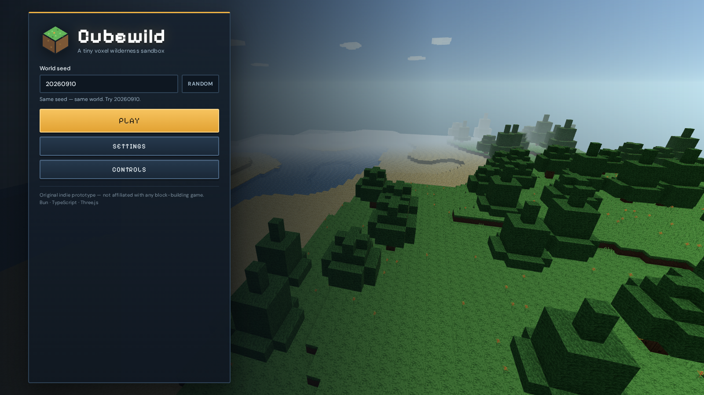

# Cubewild

A browser-based WebGL voxel sandbox prototype — original indie code, art and name.
Not affiliated with, and does not use assets from, any existing block-building game.



Cubewild is a compact creative-mode slice: procedurally generated voxel terrain with
biomes, caves, water and trees; gravity-based walking, swimming and creative flight;
block breaking and placing with a hotbar; a full menu/HUD/settings shell; drifting
clouds; and built-in screenshot support.


---

## Website

A marketing/information website for the game lives in `site/` as a Bun
workspace package. It uses the real screenshots above, ships as a static page
with no UI framework, and can bundle the playable game at `/play/`.

```bash
bun run dev:all         # one command: game :5173 + website :5174
bun run site:dev        # website dev server only → http://localhost:5174
bun run site:build      # static site build → site/dist/
bun run site:preview    # preview the built site on http://localhost:4174
bun run site:build:full # site build + game copied to site/dist/play/
bun run site:check      # site typecheck + production build
bun run site:shots      # capture desktop/mobile review screenshots
```

With `bun run dev:all` running, the website's Play buttons open the game in a
new tab automatically.

See [`site/README.md`](site/README.md) for the tooling rationale, screenshot
pipeline, accessibility notes, performance numbers and verification checklist.

---

## 1. Product interpretation

The goal is a playable, good-looking vertical slice — not a feature checklist demo.
Decisions were made to make the prototype feel like a real indie game:

- A generated world you spawn into that immediately shows terrain depth, water, trees
  and sky from a curated scenic spawn (the spawn finder scores grass, trees, water
  distance and terrain relief, so every seed gets a good opening view).
- A main menu that renders the actual game world behind a cinematic orbit camera
  instead of a static background, so the first screenshot sells the engine.
- Creative-mode feel: instant break/place, double-tap Space to fly, sprint, swimming,
  hotbar with real block icons, break particles.
- A cohesive blocky visual identity (dusk-teal + amber palette, pixel display font,
  isometric-voxel logo, beveled panels) rather than default browser UI.

## 2. Tooling/framework choice and justification

**Bun (package manager + script runner) + Vite 7 + strict TypeScript + Three.js.**

- **Bun** is required by the benchmark and used for everything: `bun install`,
  `bun run dev/build/preview/check/test/smoke/shots`, plus `bun test` for unit tests
  and `Bun.serve` for the static server used by automated screenshots. The lockfile is
  `bun.lock`; no npm/pnpm/yarn commands are needed anywhere.
- **Three.js (r183)** is the right rendering layer for a voxel prototype. It provides
  `BufferGeometry`, materials, fog, frustum culling, instancing and explicit
  `dispose()` semantics — the exact primitives a chunk mesher needs. Writing raw WebGL
  would mean owning shaders, attribute layouts, camera math and context-loss handling
  before rendering a single cube; Babylon.js is a much larger engine (full scene graph,
  PBR pipeline, editor tooling) than this prototype needs.
- **Vite 7** is the dev server/bundler: instant TS dev server, production build with
  hashed assets, and `vite preview`. It is the simplest tool that gives a proper
  dev/build/preview workflow. Bun's own bundler would work for build, but Vite's dev
  server + HMR + asset pipeline are a better fit and Vite runs cleanly under Bun.
- **Plain TypeScript + DOM UI, no React/Svelte.** The UI is four screens and a HUD.
  Direct DOM with a small state machine is less code, fewer dependencies and zero
  reconciliation during gameplay. React would add ~45 kB and complexity without
  improving a menu that renders at most once per state change.
- **No physics library.** A voxel world needs AABB-vs-grid collision, which is ~80
  lines and far more predictable than Rapier/Cannon for this use case.
- **No post-processing / shadow maps.** Per-vertex ambient occlusion and directional
  face shading baked into vertex colors give readable depth at a fraction of the cost.

## 3. Trade-offs

**Why this is not overkill:** no game engine, no UI framework, no state library, no
physics engine, no asset pipeline. Runtime dependencies are Three.js and two locally
bundled fonts. The whole game is ~4,500 lines of TypeScript across 27 focused files.

**Why this is not too limited:** Three.js is a real renderer with mature geometry,
material, fog and disposal APIs, which is what makes chunk meshing, translucency and
world streaming tractable. Vite/TS give the maintainability a prototype needs: strict
types, module boundaries, unit tests and a production build. The architecture separates
pure logic (worldgen, mesher, raycast, physics — unit-testable under `bun test`) from
rendering and DOM, so it can be extended without rewrites.

**Alternatives considered:**

- Raw WebGL: maximum control, but weeks of plumbing before gameplay; worse to maintain.
- Babylon.js: excellent engine, but heavier API surface and larger bundle for a slice.
- React/Svelte UI: nicer for complex menus; here it is overhead.
- Greedy meshing: fewer vertices, but much more complex UV/light propagation. Face
  culling + merged per-chunk buffers already eliminates ~95%+ of hidden geometry.
- Heightmap-only terrain: simpler, but caves, overhangs and beaches would not exist.

## 4. Implementation plan (as built)

1. Core utilities: seeded PRNG + hash, original Perlin noise (`fbm`/ridged), math.
2. Data model: block registry (id, solidity, opacity, textures, particles), chunk
   storage (`Uint8Array` per 16×16×96 column) + world with on-demand determinism.
3. Procedural art: 18 tiles painted in code into a canvas atlas (nearest filtering).
4. Worldgen: biome/height/temperature/moisture noise, ridged mountains, beaches,
   sea-level water, 3D-noise caves, deterministic tree/cactus/ground-cover decoration.
5. Mesher: visible-face culling, per-vertex AO, directional face shading, water
   surface offset, cross-shaped plants, all pure TS.
6. Chunk renderer: distance-sorted build queue with a per-frame time budget, water
   material with a world-space vertex wave, geometry disposal on unload, edit replay.
7. Player: AABB collision, gravity/jump, sprint, swim, creative flight, view bob;
   voxel DDA raycast; break/place with placement-inside-player protection.
8. Presentation: sky dome shader, instanced drifting clouds, fog tied to view
   distance, break particles, block highlight.
9. Shell: main menu (live world behind, seed input, settings, controls), HUD
   (crosshair, stats, badges, hotbar), pause menu, loading overlay, toasts.
10. Verification: unit tests, Playwright smoke test driving real input, automated
    screenshot capture, README and checklist.

## 5. Project layout

```
index.html                  app shell (canvas + UI root)
vite.config.ts              dev/build/preview config
src/
  main.ts                   bootstrap, ?seed= / ?shot= query params
  style.css                 full UI design system
  app/app.ts                state machine (boot/menu/playing/paused), debug API
  core/                     constants+palette, math, seeded RNG/hash, Perlin noise
  world/
    blocks.ts               block registry + hotbar
    textures.ts             procedural 16×16 tile atlas + hotbar icons
    noise helpers           (core/noise.ts)
    worldgen.ts             biomes, mountains, caves, beaches, trees, cacti
    mesher.ts               face culling + AO mesher (pure, unit tested)
    chunk.ts, world.ts      chunk data, edits, dirty tracking, edit replay
    chunkManager.ts         streaming, build budget, disposal, water shader
    spawn.ts                scenic spawn finder + spawn resolver
  player/
    player.ts               AABB physics: gravity, jump, swim, fly, view bob
    raycast.ts              Amanatides & Woo voxel DDA
  input/input.ts            keyboard/mouse, pointer lock, fly double-tap
  render/                   sky dome + clouds, block highlight, break particles
  state/settings.ts         observable settings store (localStorage)
  ui/                       dom helpers, logo, menu, pause, hud, settings, controls
tests/                      bun test: noise, worldgen, mesher, world
scripts/
  screenshots.ts            builds + captures both benchmark PNGs (Playwright)
  smoke.ts                  end-to-end gameplay smoke test in a real browser
  staticServer.ts           Bun.serve static server for dist/
public/favicon.svg
screenshots/                generated benchmark screenshots
```

## 6. Bun setup and run instructions

Requires [Bun](https://bun.sh) (developed with Bun 1.4) and a modern desktop browser
with WebGL2.

```bash
bun install       # install dependencies (uses bun.lock)
bun run dev       # game dev server on http://localhost:5173
bun run dev:all   # game + website dev servers together (see Website below)
```

## 7. Build, preview and check commands

```bash
bun run build       # production build into dist/
bun run preview     # serve the production build on http://localhost:4173
bun run typecheck   # strict tsc --noEmit
bun test            # unit tests for noise/worldgen/mesher/world (29 tests)
bun run check       # typecheck + unit tests
bun run smoke       # real-browser end-to-end gameplay test (Playwright)
bun run shots       # build + capture screenshots/main-menu.png and in-game.png
bun run shots -- --only=game        # recapture only the in-game shot
bun run shots:serve                 # serve dist/ manually (optional)
```

## 8. Controls

Documented in-game under **Controls** on the main menu and pause screen, and generated
from the same table the input layer uses (`src/input/input.ts`).

| Input                   | Action                                  |
| ----------------------- | --------------------------------------- |
| `W A S D`               | Move                                    |
| Mouse                   | Look around (click the canvas to lock)  |
| Left click              | Break block                             |
| Right click             | Place selected block                    |
| `Space`                 | Jump / fly up                           |
| Double-tap `Space` / `F`| Toggle creative flight                  |
| `Shift`                 | Fly down / sprint on land               |
| `Ctrl`                  | Fly down (alternative)                  |
| `1`–`9` / Mouse wheel   | Select hotbar block                     |
| `P`                     | Save a screenshot PNG                   |
| `Escape`                | Pause / release the mouse               |

Water is swimmable (slower movement, `Space` to swim up). `Shift` descends while
flying and sprints while walking, so there is no key conflict.

## 9. Screenshot capture

Two real screenshots are committed at `screenshots/main-menu.png` and
`screenshots/in-game.png`. They are frames rendered by the actual game: the menu shot
is the live cinematic world view behind the menu, and the in-game shot is the real
generated world with the real HUD.

### Automated (recommended)

```bash
bun run shots
```

This builds the project, serves `dist/` with `Bun.serve`, launches headless Chromium
with a software WebGL backend, waits until all chunks are streamed (the debug API
reports `pendingChunks === 0` and stable), and writes both PNGs at 1600×900. Use
`bun run smoke` as a separate end-to-end check of the gameplay loop.

### In-browser

1. `bun run dev` (or `bun run build && bun run preview`).
2. Press `P` at any time to download a PNG of the current frame.
3. For the menu shot, screenshot the menu state; for the in-game shot, press Play and
   wait a moment for chunks to stream in.

### Deterministic shot mode

- `?shot=menu` boots straight into the menu showcase.
- `?shot=game&seed=20260910` starts a game at the scenic screenshot pose (flying,
  angled at the coast) with the HUD visible and the menu hidden.
- `?seed=<number|text>` picks the world seed (the menu also has a seed field).

## 10. Performance notes

- **Chunk meshing:** only faces adjacent to a non-opaque block are emitted; a
  solid column of stone produces a handful of quads, never cubes. Each 16×16×96
  chunk becomes two `BufferGeometry` meshes (opaque + translucent water).
- **Draw calls:** ~137 chunks at view distance 6 → ~137 opaque + a few water meshes,
  plus sky, clouds and particles. Frustum culling is per-mesh and free.
- **Streaming:** chunks are generated/meshed in a distance-sorted queue with a
  per-frame budget (3 chunks or 6–9 ms), so movement stays smooth. Chunk data is
  ~24 kB each and evicted beyond the keep radius; player edits are stored separately
  and replayed when a chunk regenerates, so nothing built is lost.
- **Geometry lifetime:** meshes and geometries are explicitly disposed on unload and
  rebuild; shared materials are disposed once. No per-frame allocations of geometry,
  and no shadow maps or post-processing.
- **Lighting:** vertex-color ambient occlusion + directional face shading, one
  hemisphere light and one directional light, one shared material.
- **Measured:** chunk generation ≈2.2 ms/chunk (225 chunks in ~0.5 s), spawn search
  ~76 ms, production bundle ~572 kB JS (~149 kB gzip) including Three.js and fonts.
- **Honest caveat:** FPS numbers in the screenshots (~20–27) come from the headless
  software rasterizer used for automation; on real GPUs the prototype renders far
  faster. No hardware-GPU benchmark was run in this environment.

## 11. Verification checklist

All items below were executed in this environment (Linux, Bun 1.4, Node 24, headless
Chromium):

| Check | Result |
| --- | --- |
| `bun install` works | ✅ |
| `bun run dev` works | ✅ Vite dev server responded 200 on :5173 |
| `bun run build` works | ✅ `dist/` produced (~572 kB JS, ~30 kB CSS) |
| `bun run preview` works | ✅ served on :4173, responded 200 |
| `bun run typecheck` works | ✅ strict `tsc --noEmit` clean |
| `bun test` works | ✅ 29 tests pass (noise, worldgen, mesher, world) |
| `bun run check` works | ✅ typecheck + tests |
| `bun run smoke` works | ✅ 16/16 real-browser checks pass (including clicking the menu Play button) |
| `bun run shots` works | ✅ writes both PNGs from the real build |
| Bun is the package manager and script runner | ✅ `bun.lock`, all scripts use Bun |
| Framework/tooling choice justified | ✅ section 2–3 |
| Main menu | ✅ title, seed, play, settings, controls |
| In-game HUD | ✅ crosshair, stats, badges, hotbar, hints |
| Procedural voxel terrain | ✅ seeded noise, deterministic |
| Chunk-based loading/organization | ✅ 16×16 columns, view-distance streaming |
| Block data supports edits | ✅ `World.setBlock` + edit replay |
| Efficient visible faces | ✅ face culling + merged chunk meshes + AO |
| Gravity-based movement | ✅ AABB collision, jump, terminal velocity |
| Creative flight | ✅ double-tap Space / F, HUD badge |
| Mouse-look controls | ✅ pointer lock, sensitivity setting |
| Block breaking | ✅ DDA raycast, particles, world update |
| Block placement | ✅ replaceable check + player-volume protection |
| Block selection / hotbar | ✅ 9 slots, number keys, wheel, click |
| Pause/menu/settings UI | ✅ Escape, resume/quit, settings drawers |
| View distance control | ✅ live streaming/fog change |
| Mouse sensitivity control | ✅ live |
| Clouds / sky treatment | ✅ sky shader + drifting instanced clouds + fog |
| Terrain variation | ✅ plains, forest, desert, snowy peaks, ocean |
| Trees, hills, mountains, water, caves | ✅ all generated; beaches and cacti too |
| Controls documented in UI and README | ✅ both, single source of truth |
| Screenshot workflow documented | ✅ section 9 |
| `screenshots/main-menu.png` from the real game | ✅ automated capture |
| `screenshots/in-game.png` from the real game | ✅ automated capture |
| No fake screenshots/placeholder systems | ✅ every claimed feature has a code path |

Other verified behaviours: pointer-lock pause, pause on tab hide, water swimming and
underwater fog, break/place cooldowns, hotbar names/icons, settings persistence,
chunk edits surviving eviction, and leaf canopies always connected to trunks.

## 12. Limitations and next steps

Honest gaps in this prototype:

- **No save/load.** The world regenerates from the seed each session; edits persist
  only for the session (and across chunk eviction). LocalStorage or IndexedDB saves
  are the obvious next step.
- **No day/night cycle, weather or audio.** The sky is a fixed golden day; there are
  no sounds (which also avoids licensing questions).
- **Trees float if you dig the ground from under them** — no falling-sand/leaf decay.
- **Water does not flow.** Water exists only where worldgen placed it; breaking a
  shoreline opens a dry hole instead of flooding.
- **Single-threaded generation.** Meshing runs on the main thread with a frame
  budget; Web Workers would remove the remaining hitch when crossing chunks fast.
- **No shadows.** AO + face shading carry the depth; shadow maps over many chunks
  were judged too expensive for a prototype.
- **Mobile** is not a target: touch controls, pointer lock and small-screen HUD
  layout are out of scope, though the UI degrades gracefully at small widths.
- **Player/creature gameplay** (survival, inventory, mobs, crafting) is intentionally
  absent — this is a creative-mode slice.

## 13. Self-critique

- **What works well:** the mesher is pure and tested, worldgen is genuinely varied and
  deterministic, the spawn/screenshot poses were tuned against real captures, edits
  survive chunk eviction, and the smoke test proves the interactive loop instead of
  just asserting the bundle exists.
- **What I would do differently:** the tree decoration logic went through a rewrite —
  the first version decided trees from chunk-local block reads, which clipped canopies
  at chunk borders; making trees a pure function of a global grid cell was the right
  fix, and I should have designed it that way from the start. The scenic-spawn scoring
  also took several iterations; a small deterministic "score poses and pick the best"
  test could have shortened that loop.
- **Trade-offs I remain unsure about:** face culling instead of greedy meshing is
  ~2–3× more vertices for large flat surfaces but keeps AO and UVs simple; for a
  prototype at this world size it was the right call. Drawing water in a second mesh
  per chunk doubles some draw calls but keeps translucency simple and robust.
- **Risks:** performance on very low-end integrated GPUs was not measured; the
  view-distance slider and render scale (0.5–1.0) exist partly as escape hatches.
