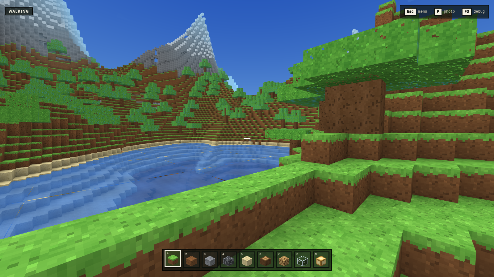

# Loamlands

An original **browser-based voxel sandbox prototype** and its **marketing site**, in one Bun + Vite + TypeScript repository. Seeded procedural terrain with biomes, caves and trees, creative flight, block building, live settings — no install, no account.

Loamlands is an indie project with its own name, palette and generated textures. It uses no assets, code, names or UI from Minecraft or any other voxel game and is not affiliated with them.



*The site itself is captured by `bun run site:check`: `screenshots/site-desktop.png` is the hero at 1440×900, and `site-desktop-1.png`…`-3.png` (and the `site-mobile-*` set at 390 px) are the full page in 4000 px pages.*

## What is in this repository

| Path | What it is |
| --- | --- |
| `index.html` | The landing page (static HTML + inline SVG art) |
| `website/` | Site stylesheet, media manifest, build-time media plugin |
| `public/media/` | Optimised screenshots and block icons served as static files |
| `play/index.html` | The game's page |
| `game/core/` | Engine-agnostic game logic (terrain, mesher, physics, raycast) — unit-tested |
| `game/engine/` | three.js layer: renderer, streaming, player, input, shaders |
| `game/ui/` | In-game HUD and menus |
| `screenshots/` | Real captures of the game (PNG) and of the site |
| `scripts/` | Image pipeline, game screenshots, end-to-end and site checks |
| `tests/` | Unit tests (`bun test`) |

## Quick start (Bun)

Requires Bun 1.2+. The automation scripts also need Chrome/Chromium (`CHROME_PATH` if it is not on `PATH`).

```bash
bun install          # dependencies
bun run dev          # http://localhost:5173 → the site · /play/ → the game
bun run build        # static production build → dist/
bun run preview      # serve dist/ → http://localhost:4173
```

| Command | Does |
| --- | --- |
| `bun run check` | Typecheck (strict), Biome lint/format, unit tests |
| `bun run test:e2e` | Drives the real game in headless Chrome (15 checks) |
| `bun run site:check` | Landing-page structure, accessibility (axe), responsiveness (18 checks); writes `screenshots/site-*.png` |
| `bun run verify` | All of the above |
| `bun run screenshot` | Re-captures the game (`screenshots/*.png`) and refreshes the site's optimised copies |
| `bun run images` | Rebuilds `public/media/` + `website/media.json` from the current `screenshots/` |
| `bun run typecheck` · `lint` · `format` · `test` | Individual checks |

---

# Part 1 — The website

## 1. Product and design interpretation

The brief asks for a landing page that feels like a real indie voxel game's site, uses the real screenshots, and stays honest about being a prototype. I read that as:

- **The screenshots are the design.** The in-game capture is the hero visual, framed like a chunk of terrain standing on a pixel landscape; the title screen, flight and settings captures follow in the same frames. Every image is a real capture.
- **One idea carries the page: scrolling is digging.** The page descends through the world — sky, surface, a dark green canopy, an ink "cave" for the technical section, stone, then back up to the sky for the call to action and down to bedrock for the footer. Each boundary is a jagged band of 16-pixel blocks in the colour of the layer below.
- **The site looks like the game because it is made from it.** Palette and type treatment come from the game's own UI (blocky 3 px borders, hard offset shadows, monospace HUD labels, `kbd` keys). Feature icons are the game's actual blocks, rendered from its generated textures.
- **Honest by construction.** A "Where the project stands" section lists what shipped, what is missing and what is next. If a screenshot is absent, the page says so with a labelled placeholder and the command to produce it.

Sections: hero, pitch ("What Loamlands is"), screens, features, controls, technical highlights, status, call to action, footer.

## 2. Tooling choice and justification

| Layer | Choice | Why |
| --- | --- | --- |
| Build | **Vite 8** (already in the repo) | One dev server and one build for both pages (`/` and `/play/`), builds in under 200 ms, hashed assets, a `public/` dir for static media. |
| Language | **TypeScript** | The media plugin and manifest renderer are typed and unit-tested like the rest of the repo. |
| UI | **Static HTML + CSS, zero client-side JavaScript** | The page has no state. Navigation is links, the art is inline SVG, and screenshots are `` with `srcset`. There is nothing to hydrate. |
| Checks | Biome, `tsc`, `bun test`, Playwright + **axe-core** | Shared with the game. |

**Why not the alternatives**

- **Astro** would be the next step up (components, an image pipeline, content collections). In this repository it would mean a second dev server and a second build that then has to be stitched around the Vite game. The one thing it would buy here — conditional markup for missing images — is 40 lines as a Vite plugin.
- **Next.js / Remix**: server rendering and routing for a single static page is pure overhead.
- **React / Svelte**: a runtime and a component model for a page with no interactivity.
- **Plain HTML with no build**: workable, but then the screenshot optimisation, hashed CSS, the `/play/` page and the shared lint/typecheck pipeline all need separate handling.

**Not overkill, not underpowered.** The site adds **no new dependency**. It is one HTML file (about a third of it inline SVG art), three stylesheets and two small TypeScript modules, covered by the same lint, typecheck and tests as the game. The structure is a conventional multi-page Vite app, so a second page is just another HTML entry.

## 3. How it is built

```
index.html                     the page: semantic sections + inline SVG art + media tokens
website/style.css              imports the three stylesheets (bundled into one file)
website/styles/base.css        tokens, reset, typography, buttons, header, footer
website/styles/decor.css       terrain strata, plants, drifting clouds
website/styles/sections.css    layout for each section
website/media.ts               manifest types, /placeholder/social-tag rendering, token expansion (pure)
website/media-plugin.ts        Vite plugin: expands tokens in index.html at build/dev time
website/media.json             generated: which screenshots/icons exist (committed)
public/media/                  generated: <shot>-<width>.webp and icon-<block>.webp (committed)
scripts/images.ts              builds the two lines above
scripts/lib/imaging.ts         image encoding through headless Chrome's canvas
scripts/lib/block-icon.ts      isometric block icons from the game's tiles
scripts/site-check.ts          visual + accessibility check; captures the hero and the full page in ≤4000 px pages
tests/media.test.ts            unit tests for the media renderer
vite.config.ts                 two HTML entries (site, game) + the media plugin
```

**Media tokens.** The page's HTML contains comments such as:

```html
<!--shot name="in-game" alt="…" sizes="(min-width: 1168px) 1112px, calc(100vw - 3.5rem)" fetch="high"-->
<!--icon name="grass" class="card__img"-->
<!--social-image name="in-game"-->
```

At build time (and in the dev server) the plugin replaces them with either a responsive `` (WebP `srcset`, intrinsic `width`/`height`, `alt`, lazy/eager loading) or a clearly labelled placeholder. The shipped HTML is static; nothing runs in the browser.

## 4. Screenshots: where they live and how they are used

1. **Sources of truth:** `screenshots/main-menu.png`, `in-game.png`, `flight.png`, `settings.png` — real captures written by `bun run screenshot` (the first two are the files the original brief asked for).
2. **Optimised copies:** `bun run images` turns each PNG into 640/960/1280/full-width WebP in `public/media/` (1.5 MB PNG → 98 KB at 1280 px), renders the block icons, and writes `website/media.json`. `bun run screenshot` runs this automatically afterwards.
3. **On the page:** the hero uses `in-game`; the Screens section uses `main-menu`, `flight` and `settings`. Each has descriptive alt text and a caption.
4. **If a screenshot is missing:** the manifest has no entry, the build still succeeds, and that slot renders a striped panel labelled **Placeholder** with the expected path and the command to run. Verified by building with an empty manifest.
5. **To add or replace a screenshot:** drop a PNG in `screenshots/` (any name), run `bun run images`, then reference it with a `<!--shot name="<file-name-without-extension>" …-->` token.

The capture script presses the game's `H` key (hide the stats panel) before the in-game and flight shots: headless Chrome renders on the CPU, so its frame-rate readout would misrepresent the game on real hardware. Nothing else in the frame is altered.

Link previews: `bun run build` emits Open Graph/Twitter image tags only when `SITE_URL=https://your-domain` is set (crawlers need absolute URLs) — for example `SITE_URL=https://loamlands.example bun run build`.

## 5. Accessibility

- Semantic landmarks (`header`, `nav`, `main`, `footer`, `section` with `aria-labelledby`), one `h1`, no skipped heading levels, a skip link as the first Tab stop.
- Real links and buttons only; the nav needs no menu toggle (it wraps to a second row on phones), so keyboard use is complete without JavaScript.
- Every screenshot has descriptive `alt`; decorative art is `aria-hidden` or has empty `alt`.
- Colour contrast was checked with axe-core (WCAG 2.0/2.1 A + AA): zero violations of any severity on the built page.
- `prefers-reduced-motion` stops the cloud animation, the smooth scrolling and button transitions; no content depends on motion or hover.
- Body text is 17 px, small text ≥ 12 px; tables keep header cells; `kbd` marks keys.

## 6. Performance

- **No client-side JavaScript** for the site. HTML 38.6 KB (8.1 KB gzipped, including all inline SVG art), CSS 14.9 KB (4.1 KB gzipped). No web fonts — the system stack is used.
- **Images:** responsive WebP with `srcset`/`sizes`; the hero is eager with `fetchpriority="high"` (33 KB on phones, 98 KB at 1280 px); everything else is `loading="lazy"`. Explicit `width`/`height` on every image means no layout shift. Icons are ~3 KB each.
- **Only needed requests:** the game's 152 KB bundle is on `/play/`, never on the landing page.
- Verified by `bun run site:check`: no failed requests, no console errors.

## 7. Website verification checklist

Run in this environment (Linux, Bun 1.4.2, Chrome 158, software WebGL):

| Item | Status |
| --- | --- |
| `bun install` | ✅ |
| `bun run dev` | ✅ site at `/`, game at `/play/` |
| `bun run build` | ✅ under 200 ms; `dist/index.html`, `dist/play/index.html`, `dist/media/` |
| `bun run preview` | ✅ both pages served |
| `bun run typecheck` / `lint` | ✅ clean (Biome: `noDescendingSpecificity` is off because it only flagged cross-section false positives; `role="list"` on `ul`/`ol` is kept for Safari/VoiceOver and allowed in `index.html`) |
| `bun test` | ✅ 34 unit tests (26 game, 8 site media) |
| `bun run site:check` | ✅ 18 checks, including: one `h1`, landmarks, heading order, all sections present, in-page links resolve, `/play/` serves the game, skip link first and visible, reduced motion honoured, every `` has `alt` and decodes (4 described screenshots, 8 decorative icons), axe-core WCAG A/AA clean, no horizontal overflow at 360/390/768/1024/1440 px, no console errors |
| Missing screenshots | ✅ build succeeds; labelled placeholders with instructions (verified with an empty manifest) |
| Sections: hero, pitch, screens, features, controls, technical, status, CTA, footer | ✅ |
| Real screenshots used | ✅ four, all referenced from `screenshots/` via `public/media/` |
| Responsive | ✅ desktop, tablet (820 px) and phone (390 px) reviewed from captures |

## 8. Website limitations and next steps

- The **Play buttons link to `./play/`**, i.e. to the game built alongside the site. Deploying the site on its own means pointing those links at a hosted game.
- One hand-written HTML file. A second page or a blog would outgrow it; that is the point to move to Astro or add real templating.
- System fonts keep the site fast and consistent with the game, but the typography is not distinctive.
- No analytics, no cookie banner, no newsletter — nothing is tracked because nothing is collected.
- Social-preview image tags need `SITE_URL` at build time; there is no canonical URL otherwise.

## 9. Website self-critique

- The media token plugin is a small home-grown templating step. It is tested and tiny, but it is one more thing a newcomer has to learn before editing `index.html`.
- The page is long (~8,500 px on desktop). The rhythm of light and dark sections keeps it readable, but the technical section could be shorter for non-developers.
- The inline pixel art (strata, plants, logo) is about 130 lines of SVG in the HTML. It ships for free and stays crisp, but it is not designer-authored illustration.
- Mobile gets the same content with no menu toggle; on a 360 px phone the header is three rows tall.
- Screenshots come from a software rasteriser, so they show no anti-aliasing quality differences from real GPUs — but also no motion; a short capture of flight would sell the game better than a still.

---

# Part 2 — The game

## 1. Product interpretation

A compact creative-mode slice: one polished loop (spawn → explore → fly → build) with a strong first impression.

- **First frame matters.** The title screen is a live camera over the actual world, aimed down the vista the player will see on Play. A deterministic spawn finder picks a dry, level, slightly elevated column with an open line of sight toward water, mountains and trees.
- **Creative mode only.** No health, hunger, mobs, inventory or crafting. Blocks are unlimited; the 9-slot hotbar is the palette.
- **Terrain is the content.** Continental + hill noise, ridged mountains with snow caps, seven biomes, spaghetti caves and caverns with ore veins, and trees that cross chunk borders consistently.
- **Feel over features.** Baked ambient occlusion, block-break particles tinted by the block, water with a lowered surface and shader ripple, a drifting blocky cloud layer, a 0.9 s camera hand-off from title to first person, jump buffering, swim-to-shore hopping.

## 2. Tooling

| Layer | Choice | Why |
| --- | --- | --- |
| Package manager / runner | **Bun** | `bun run <script>`, `bun test`, and Bun runs all automation scripts. |
| Renderer | **three.js** (only runtime dependency) | `BufferGeometry`, per-mesh frustum culling, `DataArrayTexture`, GLSL3 shader materials. The chunk shader (baked lighting, fog, water ripple) is written in this repo. |
| UI | **Vanilla TypeScript + DOM** | Four screens and a HUD updating a few text nodes at 5 Hz. |
| Automation | **Playwright** (dev) | Headless Chrome drives the real game for screenshots and the end-to-end test. |

**Not Babylon.js** (a full engine for one custom shader), **not raw WebGL2** (three.js removes exactly the boilerplate I would otherwise hand-roll for ~150 KB gzipped), **not React/R3F** (a declarative layer fights the imperative mesher and game loop).

## 3. Architecture

```
play/index.html            game page: canvas + menu/pause/settings/controls/HUD markup
game/main.ts               boot, wiring, fatal-error screen
game/style.css             in-game visual identity
game/core/                 engine-agnostic, unit-tested (no DOM, no three.js)
  rng.ts noise.ts          seeded hashing, PRNG, simplex 2D/3D, fBm, ridged
  textures.ts              17 procedural 16×16 tiles → 2D texture array
  blocks.ts                block registry (tiles, solid/opaque/liquid/glow flags), hotbar
  chunk.ts world.ts        16×128×16 byte storage, chunk map, block get/set, dirty tracking
  terrain.ts spawn.ts      deterministic generator; spawn finder
  mesher.ts raycast.ts collision.ts   visible-face mesher with AO; voxel DDA; swept AABB
  settings.ts              typed settings with ranges, sanitising, localStorage
game/engine/               three.js layer
  game.ts                  screens, main loop, interaction, settings, screenshot
  chunkManager.ts          streaming plan + per-frame time budget (generate r+1, mesh r)
  chunkView.ts             one or two meshes per chunk; dispose on unload
  materials.ts             chunk/sky/cloud shaders, shared uniforms
  player.ts input.ts       movement/gravity/flight/swim; pointer lock, double-tap, edge-triggered presses
  sky.ts clouds.ts highlight.ts particles.ts bridge.ts
game/ui/                   hud.ts (hotbar icons drawn from the tile data) menus.ts (screens, settings)
```

**Data flow:** `TerrainGenerator` fills `Chunk.data` → `buildChunkMesh` emits only exposed faces → `ChunkRenderer` uploads indexed `BufferGeometry` (position, uv, packed `[tile, light]`) → one draw call per chunk per pass. Edits go through `World.setBlock`, which returns the affected chunks (including border and diagonal neighbours) for an immediate rebuild.

**Determinism:** everything derives from `hashSeed(seedText)` — a seeded simplex permutation, per-column hashes for trees and ores, and a three-block margin when generating trees so canopies are written identically by every chunk they touch.

## 4. Controls

| Input | Action |
| --- | --- |
| `W` `A` `S` `D` | Move |
| Mouse | Look (pointer lock) |
| `Space` | Jump · swim up · fly up |
| `Space` ×2 | Toggle flying (land to stop flying) |
| `Shift` | Sprint while walking · fly down while flying |
| Left click | Break block (hold to repeat) |
| Right click | Place block (hold to repeat) |
| `1`–`9`, scroll wheel | Select hotbar slot |
| `Esc` | Pause / release the mouse · `Esc` again resumes |
| `P` | Save a PNG of the 3D view |
| `F3` | Toggle debug stats |
| `H` | Hide or show the stats panel |

The same table is available in the game under **Controls**.

## 5. Settings

All apply immediately and persist in `localStorage`: **view distance** (3–12 chunks; fog follows; lowering it unloads the excess at once), **mouse sensitivity** (0.2×–2×), **field of view** (60–110°), **render scale** (0.5×–2× of device pixel ratio, capped at 2× DPR), **clouds**, **debug stats** (`F3`), **stats panel** (`H`).

## 6. Screenshots

`screenshots/main-menu.png` and `screenshots/in-game.png` are the files the original brief asked for; `flight.png` and `settings.png` are two more real captures used by the site.

```bash
bun run screenshot                     # all four + refreshes public/media/ (builds dist/ and serves it)
bun run screenshot --seed ember        # different world
bun run screenshot --out shots --width 1920 --height 1080
bun run screenshot --no-media          # skip the website refresh
LOAMLANDS_URL=http://localhost:5173 bun run screenshot   # reuse a running dev server
```

The script waits for `window.loamlands.whenIdle()` (all chunks generated and meshed) before each capture. In game, `P` (or *Paused → Save screenshot*) downloads `loamlands-<timestamp>.png` of the 3D canvas only (the HUD is DOM and is not included).

## 7. Performance notes

- **Geometry:** one indexed `BufferGeometry` per chunk per pass; hidden faces between opaque blocks are never emitted; the mesher stops at the highest non-air block. Default view distance 8 = **225 chunk meshes**, ≈**170 draw calls** after frustum culling, ≈**580 k triangles**.
- **Streaming:** nearest-first queue with a per-frame time budget (24 ms on the title screen, 5 ms in play); generation for radius + 1 so border faces and AO are correct; meshes beyond range are disposed, block data stays.
- **Shading:** directional face shade × ambient occlusion baked per vertex; the fragment shader samples a texture array and applies fog.
- **Textures:** 17 procedural tiles in one `DataArrayTexture` — no atlas bleeding, no downloads.
- **Measured here** (headless Chrome on a software rasteriser, 1600×900): 20–28 fps, initial stream of 225 chunks in 3–5 s. A real GPU was not available in this environment; the draw-call and triangle counts above are what a GPU sees.
- Bundle: **152 KB gzipped JS**, 3.2 KB CSS, no image, font or audio files.

## 8. Game verification checklist

| Item | Status |
| --- | --- |
| `bun run dev` / `build` / `preview` | ✅ game at `/play/` in all three |
| `bun test` | ✅ 26 game unit tests: determinism, bounds, biomes/trees/ores/caves, world edits, spawn, mesher culling/AO/water, collision sweeps, raycast |
| `bun run test:e2e` | ✅ 15 checks on the production build: menu → Play → spawn on ground → break/place → walk → jump/land → flight toggle/rise/descend/land → mouse look → hotbar keys/wheel → Esc pause/resume → settings apply + persist → `H` hides stats + persists → `P` downloads PNG → quit to title → no page errors |
| `bun run screenshot` | ✅ four real captures |
| Procedural terrain, chunks, editable block data, visible-face meshing | ✅ |
| Gravity, jump, creative flight (double-tap, HUD badge), mouse look | ✅ |
| Block breaking / placement (placement blocked inside the player) | ✅ |
| View distance + sensitivity settings, applied live | ✅ |
| Clouds + procedural sky; trees, beaches, hills, mountains, water, caves | ✅ |
| No copyrighted assets, no Minecraft naming | ✅ |

## 9. Game limitations and next steps

- No persistence of edits across reloads (world data is in memory). Next: serialise edited chunks to IndexedDB keyed by seed.
- Single-threaded generation/meshing; a Web Worker pool would remove the remaining hitches when sprint-flying across chunks.
- Water is static (no flow); leaves are a cutout material; lamps render lit but do not illuminate neighbours.
- No day/night cycle, sound or touch controls; pointer lock and WASD assume a desktop browser.
- Chunk *data* is never unloaded (32 KB each); fine for a session, would need an LRU for long play.
- Only one tree shape and one grass tint; per-biome vertex tinting and a second species would sell the biomes better.

## 10. Game self-critique

- Terrain is pretty but not varied at the block level: biomes differ by surface block and tree density only.
- Lighting is baked face shade + AO: no shadows, no light propagation.
- The spawn finder is tuned by scoring heuristics; a seed with no good vista within 48 blocks still gets the best available spot, not a guaranteed postcard.
- The e2e test relies on the default seed's spawn being open ground ahead; changing the default seed may need its assumptions revisited.
- Real-GPU performance is not measured here.

---

## Automation notes

Under browser automation (`navigator.webdriver` is true) the game skips pointer lock and behaves as if the pointer were captured, so scripts can drive it. `window.loamlands` exposes a read-only state object and `whenIdle()`. Both are documented in the code and used only by `scripts/`.
